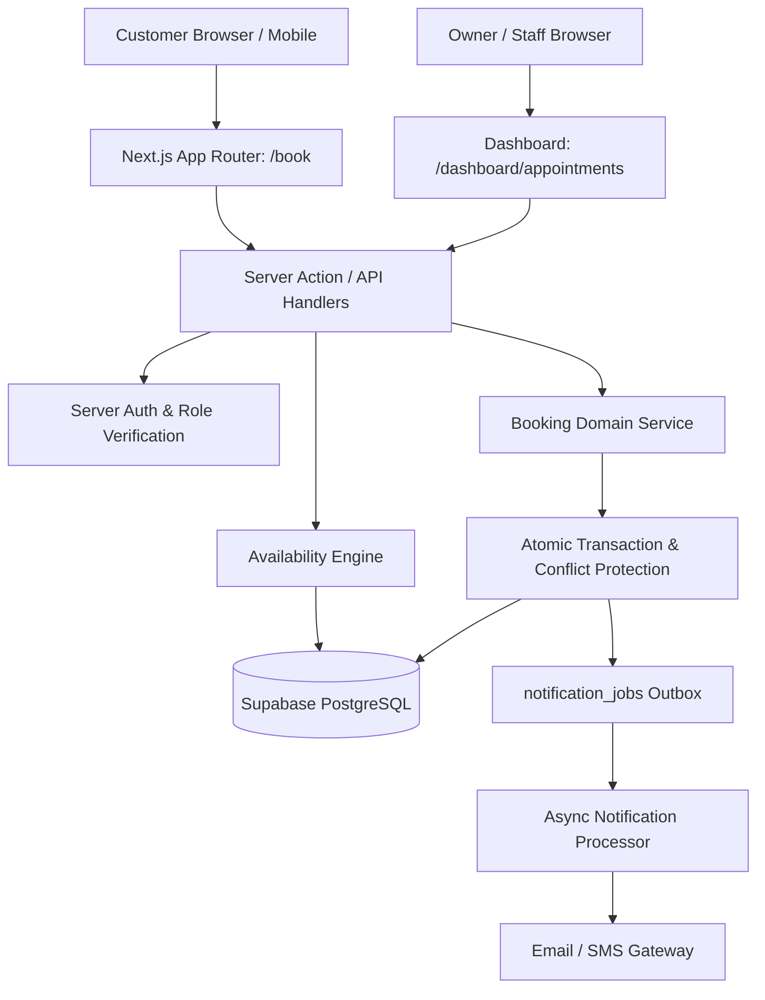
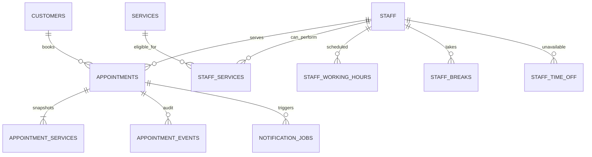
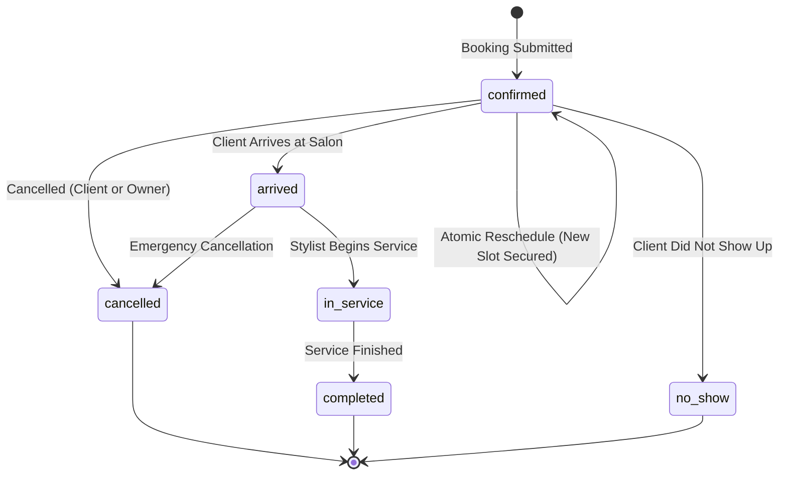

# Product Requirements Document — V2 Appointment Booking Management

**Document Status:** Approved Single Source of Truth for V2 Booking  
**Product:** `salon-website-eco`  
**Active Release Target:** V2 — Phase 1 (Appointment Booking Management MVP)  
**Primary Source:** `salon-v2-booking-blueprint.zip` + Existing V1.5 Baseline + `PRODUCT_VISION.md`  
**Audience:** Solo beginner developer and AI coding agent  

---

## 1. Goals, Assumptions and Scope

### 1.1 Context
V1 and V1.5 established the public salon website, content management system (CMS), enquiry pipeline, privacy-friendly analytics, and security hardening. V2 expands the platform into business operations, starting with **Appointment Booking Management** as the first priority. All existing V1 and V1.5 public pages, CMS functionality, and data must continue working without interruption.

### 1.2 Core Goals
1. **Customer Self-Service:** Customers can view services, prices, durations, staff preferences, and real-time available time slots to book appointments.
2. **Double-Booking Prevention:** Guaranteed transactional integrity and database-enforced conflict prevention so no staff member is ever double-booked.
3. **Owner & Staff Operational Control:** Salon owner and staff can view schedules, manage appointments (confirm, reschedule, cancel), record attendance, and manage staff working hours, breaks, and time off.
4. **Historical Data Integrity:** Historical bookings remain immutable even when service prices, durations, or names are modified in the CMS catalogue.
5. **Asynchronous Reliability:** Booking creation is decoupled from notification delivery, preventing third-party message gateway issues from disrupting appointment creation.

### 1.3 Scope Boundaries & Non-Goals for MVP
- **In Scope (MVP):**
  - Single salon location (India Standard Time: `Asia/Kolkata`).
  - Multiple staff members with service assignment mapping.
  - In-person appointments.
  - Guest booking with optional customer account linking.
  - Direct atomic booking with instant confirmation (no payment gateway in initial MVP).
  - Single service booking per transaction (multi-service extensible via data model).
  - Owner manual booking creation, cancellation, and rescheduling with audit logging.
- **Explicitly Out of Scope (Deferred to Later V2 Phases):**
  - Online payments, deposits, and refunds (Phase 2 of V2).
  - Google Calendar two-way synchronization.
  - Automated waitlist allocation.
  - Recurring appointments and group/class bookings.
  - Multi-salon tenancy and SaaS subscription billing.
  - Staff commission, inventory tracking, and payroll.
  - Automated WhatsApp AI bot receptionist.

---

## 2. User Roles and Requirements

### 2.1 Public Visitor / Guest Customer
- Browse active, bookable services with transparent pricing and duration.
- Check live slot availability for a selected service, date, and staff preference.
- Book using name and phone number (email optional).
- Receive a secure public booking reference (e.g., `AL-BK-7X29K`) and confirmation details.
- Access self-service cancellation or reschedule options strictly within salon policy cutoffs.
- Zero ability to view or tamper with other customers' bookings.

### 2.2 Registered Customer Account
- All capabilities of a guest customer.
- Authenticated dashboard (`/account/appointments`) displaying upcoming and past appointments.
- Option to link prior guest bookings to account after verified phone/email confirmation.

### 2.3 Staff Member
- Secure login to staff view (`/staff/appointments`).
- View personal schedule, upcoming appointments, and daily client list.
- Update operational appointment statuses: `arrived`, `in_service`, `completed`, `no_show`.
- View only permitted customer details (name, phone, service note); no access to salon-wide revenue or other staff private data.

### 2.4 Salon Owner / Manager
- Full access via owner dashboard (`/dashboard/appointments`, `/dashboard/staff`).
- Configure staff members, weekly working hours, recurring breaks, and time off / leave.
- Assign services to staff members (`staff_services`).
- View salon-wide calendar and filterable appointment list.
- Create manual in-person or phone appointments.
- Perform privileged reschedules, cancellations with mandatory reason, and emergency slot overrides with full audit event logging.

---

## 3. Booking Workflow and UI States

### 3.1 Customer Booking Journey (Mobile-First 8-Step Flow)
1. **Service Selection:** Choose active service from catalogue (or arrive via deep-link `/book?service=<id>`).
2. **Staff Preference:** Select specific eligible stylist or choose "Any Available Staff".
3. **Date Selection:** Choose date within the allowable advance window (up to 30 days ahead).
4. **Time Slot Selection:** Select from real-time server-calculated available start times.
5. **Customer Details:** Provide full name and phone number (E.164 formatted), optional email and notes.
6. **Summary & Policy Review:** Inspect selected service, staff, date/time in IST, duration, total price, and cancellation rules.
7. **Submission:** Atomic reservation submission with client-side idempotency protection.
8. **Confirmation:** Success screen with unique booking reference, calendar add link, and next steps.

### 3.2 Required UI States
- **Availability Loading:** Elegant skeleton or spinner while slots are calculated.
- **Empty State (No Slots Available):** Clear guidance with suggestions to try another date or staff member.
- **Service/Staff Inactive:** Friendly warning if a selected service or staff member is unavailable.
- **Slot Taken During Checkout (`SLOT_UNAVAILABLE`):** Non-intrusive alert explaining that the slot was just taken, with 1-click slot refresh.
- **Network Retry State:** Retry button preserving form inputs and idempotency key.
- **Inline Field Validation:** Explicit error messages adjacent to invalid inputs.
- **Booking Confirmed:** Branded confirmation card with reference number and salon address.
- **Cancellation Cutoff Passed:** Informative rejection message explaining salon notice rules.
- **Reschedule Conflict:** Clear warning when requested new reschedule time is unavailable.

---

## 4. Architecture and API Boundaries

### 4.1 Modular Monolith Architecture
Following **ADR-001**, the booking system is implemented as a modular domain inside the existing Next.js App Router and Supabase PostgreSQL stack. No microservices or external orchestration servers are required for the MVP.



### 4.2 Booking Write Path Sequence
1. Server receives request with client-generated idempotency key.
2. Server validates input schema and normalizes phone number.
3. Server looks up canonical service duration and price from database (never trusts client price).
4. Database transaction initiated:
   - Locks target staff/time window or checks exclusion constraint.
   - Verifies staff eligibility and working hours.
   - Inserts `appointments` record with unique random `public_reference`.
   - Inserts `appointment_services` with duration and price snapshot.
   - Inserts `appointment_events` audit record.
   - Enqueues `notification_jobs` record in transactional outbox.
5. Transaction commits atomically.
6. Server returns HTTP 201 with public reference and appointment summary.

### 4.3 Proposed API Surface
- `GET  /api/booking/services` — List active bookable services.
- `GET  /api/booking/staff?serviceId=<id>` — List active eligible staff for service.
- `GET  /api/booking/availability?serviceId=<id>&date=YYYY-MM-DD&staffId=<id>` — Calculate available slots.
- `POST /api/booking/appointments` — Create appointment (atomic, idempotent).
- `GET  /api/booking/appointments/[reference]` — Fetch appointment details (secure token / reference).
- `POST /api/booking/appointments/[id]/cancel` — Customer cancellation (cutoff guarded).
- `POST /api/booking/appointments/[id]/reschedule` — Customer reschedule (atomic slot swap).
- `GET  /api/admin/appointments` — Owner/staff appointment list & calendar data.
- `POST /api/admin/appointments` — Owner manual appointment creation.
- `PATCH /api/admin/appointments/[id]/status` — Operational status transition.
- `GET/POST/PATCH /api/admin/staff` — Staff management.
- `GET/POST/PATCH /api/admin/staff/schedules` — Staff hours, breaks, and time off.

### 4.4 Machine-Readable Error Contract
All API endpoints return standard structured errors:
- `VALIDATION_ERROR` (400): Malformed input or missing required fields.
- `SERVICE_UNAVAILABLE` (400): Service is inactive or non-bookable.
- `STAFF_NOT_ELIGIBLE` (400): Selected staff cannot perform requested service.
- `SLOT_UNAVAILABLE` (409): Target time slot has a conflict or was just booked.
- `BOOKING_WINDOW_CLOSED` (400): Slot violates minimum notice (2h) or advance window (30d).
- `APPOINTMENT_NOT_FOUND` (404): No appointment matches ID or reference.
- `INVALID_STATE_TRANSITION` (400): Status change disallowed by state machine.
- `CANCELLATION_CUTOFF_PASSED` (403): Cancellation attempted within cutoff window.
- `RATE_LIMITED` (429): Excessive booking attempts from client.
- `IDEMPOTENCY_KEY_REUSED` (409): Same idempotency key used with conflicting payload.
- `INTERNAL_ERROR` (500): Generic safe error message with correlation ID.

---

## 5. Data Model and Migration Requirements

### 5.1 Entity Relational Diagram


### 5.2 Schema Specification

#### `staff`
- `id` (UUID, PK, `default gen_random_uuid()`)
- `profile_id` (UUID, Nullable, FK `profiles.id`, UNIQUE when present)
- `display_name` (TEXT, NOT NULL)
- `phone` (TEXT, Nullable)
- `email` (TEXT, Nullable)
- `avatar_url` (TEXT, Nullable)
- `is_active` (BOOLEAN, NOT NULL, DEFAULT true)
- `created_at`, `updated_at` (TIMESTAMPTZ, NOT NULL, DEFAULT `now()`)

#### `staff_services`
- `staff_id` (UUID, FK `staff.id` ON DELETE CASCADE)
- `service_id` (UUID, FK `services.id` ON DELETE CASCADE)
- `is_active` (BOOLEAN, DEFAULT true)
- PRIMARY KEY (`staff_id`, `service_id`)

#### `staff_working_hours`
- `id` (UUID, PK)
- `staff_id` (UUID, FK `staff.id` ON DELETE CASCADE)
- `weekday` (SMALLINT, CHECK `weekday BETWEEN 0 AND 6`) -- 0 = Sunday
- `opens_at` (TIME, NOT NULL)
- `closes_at` (TIME, NOT NULL)
- `effective_from` (DATE, Nullable)
- `effective_until` (DATE, Nullable)
- CONSTRAINT: `closes_at > opens_at`

#### `staff_breaks`
- `id` (UUID, PK)
- `staff_id` (UUID, FK `staff.id` ON DELETE CASCADE)
- `weekday` (SMALLINT, Nullable, CHECK `weekday BETWEEN 0 AND 6`)
- `starts_at` (TIME, NOT NULL)
- `ends_at` (TIME, NOT NULL)
- CONSTRAINT: `ends_at > starts_at`

#### `staff_time_off`
- `id` (UUID, PK)
- `staff_id` (UUID, FK `staff.id` ON DELETE CASCADE)
- `starts_at` (TIMESTAMPTZ, NOT NULL)
- `ends_at` (TIMESTAMPTZ, NOT NULL)
- `reason` (TEXT, Nullable)
- `created_by` (UUID, Nullable)
- CONSTRAINT: `ends_at > starts_at`

#### `customers`
- `id` (UUID, PK)
- `profile_id` (UUID, Nullable, FK `profiles.id`)
- `full_name` (TEXT, NOT NULL)
- `phone_e164` (TEXT, NOT NULL)
- `email_normalized` (TEXT, Nullable)
- `phone_verified_at` (TIMESTAMPTZ, Nullable)
- `created_at`, `updated_at` (TIMESTAMPTZ, NOT NULL, DEFAULT `now()`)

#### `appointments`
- `id` (UUID, PK)
- `public_reference` (TEXT, UNIQUE, NOT NULL) -- e.g. 'AL-BK-9X42A'
- `customer_id` (UUID, FK `customers.id`)
- `staff_id` (UUID, FK `staff.id`)
- `status` (TEXT, NOT NULL, CHECK `status IN ('confirmed', 'arrived', 'in_service', 'completed', 'cancelled', 'no_show')`)
- `starts_at` (TIMESTAMPTZ, NOT NULL)
- `ends_at` (TIMESTAMPTZ, NOT NULL)
- `timezone` (TEXT, NOT NULL, DEFAULT 'Asia/Kolkata')
- `source` (TEXT, NOT NULL, CHECK `source IN ('online', 'owner_manual', 'staff_manual')`)
- `customer_note` (TEXT, Nullable)
- `internal_note` (TEXT, Nullable)
- `cancelled_at` (TIMESTAMPTZ, Nullable)
- `cancelled_by` (UUID, Nullable)
- `cancellation_reason` (TEXT, Nullable)
- `idempotency_key` (TEXT, Nullable)
- `created_at`, `updated_at` (TIMESTAMPTZ, NOT NULL, DEFAULT `now()`)
- CONSTRAINT: `ends_at > starts_at`

#### `appointment_services` (Snapshot Integrity)
- `id` (UUID, PK)
- `appointment_id` (UUID, FK `appointments.id` ON DELETE RESTRICT)
- `service_id` (UUID, FK `services.id`)
- `service_name_snapshot` (TEXT, NOT NULL)
- `duration_minutes_snapshot` (INTEGER, NOT NULL, CHECK `duration_minutes_snapshot > 0`)
- `price_paise_snapshot` (BIGINT, NOT NULL, CHECK `price_paise_snapshot >= 0`)
- `quantity` (INTEGER, NOT NULL, DEFAULT 1)

#### `appointment_events` (Audit Log)
- `id` (UUID, PK)
- `appointment_id` (UUID, FK `appointments.id` ON DELETE CASCADE)
- `actor_profile_id` (UUID, Nullable)
- `event_type` (TEXT, NOT NULL)
- `from_status` (TEXT, Nullable)
- `to_status` (TEXT, Nullable)
- `reason` (TEXT, Nullable)
- `metadata` (JSONB, Nullable)
- `created_at` (TIMESTAMPTZ, NOT NULL, DEFAULT `now()`)

#### `notification_jobs` (Transactional Outbox)
- `id` (UUID, PK)
- `appointment_id` (UUID, FK `appointments.id` ON DELETE SET NULL)
- `event_key` (TEXT, UNIQUE, NOT NULL)
- `channel` (TEXT, NOT NULL, CHECK `channel IN ('email', 'sms', 'whatsapp')`)
- `recipient` (TEXT, NOT NULL)
- `template_key` (TEXT, NOT NULL)
- `status` (TEXT, NOT NULL, CHECK `status IN ('queued', 'processing', 'sent', 'retry', 'failed', 'cancelled')`)
- `attempt_count` (INTEGER, NOT NULL, DEFAULT 0)
- `next_attempt_at` (TIMESTAMPTZ, Nullable)
- `last_error` (TEXT, Nullable)
- `created_at`, `updated_at` (TIMESTAMPTZ, NOT NULL, DEFAULT `now()`)

### 5.3 Service Price Conversion Strategy
- Current V1.5 `services` table stores price as text (e.g., `"₹450"`, `"₹2,500+"`).
- During migration, an additive integer column `price_paise` (e.g., `45000` for `₹450`) will be added alongside existing text column.
- Existing price strings will be parsed safely using a migration script without altering or deleting existing text data.

---

## 6. Appointment Lifecycle and State Transitions

### 6.1 State Machine


### 6.2 State Transition Rules
- **Terminal States:** `completed`, `cancelled`, and `no_show` are final. Normal operational staff cannot reopen them. Reopening requires owner override with mandatory reason.
- **Atomic Reschedule:** A reschedule command updates `starts_at` and `ends_at` within a single database transaction, securing the new slot before releasing the previous slot. An audit event records both previous and new timestamps.
- **Client Cancellation Cutoff:** Customers can cancel online only if current time is at least 4 hours prior to appointment start time. Inside 4 hours, cancellation requires contacting salon staff directly.

---

## 7. Availability and Scheduling Rules

1. **Working Hours:** Slots must fall entirely within the assigned staff member's working hours for that day of week.
2. **Breaks & Time Off:** Any slot overlapping recurring staff breaks or approved `staff_time_off` is filtered out.
3. **Existing Bookings:** Conflicting active appointments (`confirmed`, `arrived`, `in_service`) remove overlapping time intervals.
4. **Interval Definition:** Time intervals are treated as half-open ranges `[starts_at, ends_at)` so an appointment ending at 11:30 AM allows another to begin at exactly 11:30 AM.
5. **Buffer Times:** Global buffer is 0 minutes for MVP; slot generator supports extensible per-service post-service cleaning/buffer intervals.
6. **Minimum Notice:** Minimum 2 hours from current time (`now() + interval '2 hours'`).
7. **Advance Window:** Maximum 30 days into the future.
8. **Slot Increments:** Slot start times generated on 15-minute boundaries, ensuring the full service duration fits before closing or breaks.

---

## 8. Concurrency and Double-Booking Prevention

Following **ADR-002**, client availability display is strictly advisory; the database write transaction is the ultimate authority.

### 8.1 Prevention Mechanism
- Preferred implementation uses a PostgreSQL exclusion constraint:
  ```sql
  -- Prevents overlapping active bookings for the same staff member
  ALTER TABLE public.appointments
  ADD CONSTRAINT no_overlapping_staff_appointments
  EXCLUDE USING gist (
    staff_id WITH =,
    tstzrange(starts_at, ends_at, '[)') WITH &&
  )
  WHERE (status IN ('confirmed', 'arrived', 'in_service'));
  ```
- *Fallback Strategy:* If `btree_gist` extension is restricted, the write path uses an explicit database transaction with `FOR UPDATE` row-level locking on the target staff schedule partition before conflict verification and insertion.
- Two simultaneous requests for the exact same staff and slot will result in one successful 201 Created and one graceful 409 Conflict (`SLOT_UNAVAILABLE`).

---

## 9. Authentication, Authorization, Security and Privacy

1. **Server-Side Authorization:** Every dashboard and API route enforces server-side role validation (`owner`, `staff`, `user`). Client-side route checks are purely cosmetic.
2. **Defense-in-Depth RLS:**
   - `appointments`: Owners can read/update all; staff can read/update own assigned appointments; customers can read only their own appointments via `customer_id`.
   - `staff`, `staff_working_hours`, `staff_services`: Public can read active staff/services; only owners can insert/update/delete.
   - Public booking endpoint runs via secure server action / API route with input validation.
3. **No Service-Role Key Exposure:** `SUPABASE_SERVICE_ROLE_KEY` is strictly confined to server-side environments; never exposed to client bundles or browser code.
4. **Rate Limiting & Honeypot:** Public booking endpoints are protected by IP and phone rate limits to prevent brute-force slot enumeration or bot spam.
5. **Privacy & Data Minimization:** Collect only client name, phone number, and optional email. No sensitive financial credentials or unnecessary tracking.

---

## 10. Notifications and Future Payment Integration

### 10.1 Asynchronous Outbox Pattern
Following **ADR-005**, notification dispatch is completely decoupled from the booking write transaction:
- The write transaction inserts a row into `notification_jobs` (`status = 'queued'`).
- A background worker processes jobs, calls messaging gateways, records attempt counts, and applies exponential backoff on retry.
- If an email or SMS gateway fails, the appointment remains 100% valid and confirmed in the database.

### 10.2 Future Payment Gateway Integration (ADR-003)
- Initial MVP uses in-person pay-at-salon.
- Schema includes `price_paise_snapshot` to ensure seamless compatibility when online payment (Razorpay / UPI) is introduced in Phase 2.
- Future payment flow will use short-lived slot holds (`booking_holds`) with strict expiration timestamps.

---

## 11. Comprehensive Edge-Case Matrix

| # | Edge Case Scenario | Risk / Problem | Expected System Behavior | Prevention & Handling Mechanism |
|---|---|---|---|---|
| 1 | Concurrent booking for same slot | Double-booking race condition | Exactly one booking succeeds; second gets 409 | PostgreSQL exclusion constraint / transaction lock |
| 2 | Browser disconnects during submit | Customer unsure if booking created | Retrying with same key returns original confirmation | Client idempotency key + random public reference |
| 3 | Service duration updated in CMS | Old appointments recalculated incorrectly | Historical appointment duration preserved | Duration snapshot in `appointment_services` |
| 4 | Service price updated in CMS | Old invoices/bookings show new price | Historical booked price preserved | Price snapshot in `appointment_services` |
| 5 | Staff member takes emergency leave | Existing bookings overlap leave | System flags conflicts for owner resolution | Conflict warning dashboard; bookings never moved silently |
| 6 | Staff member deactivated | Bookings orphaned | New bookings blocked; future bookings highlighted | Deactivation check with re-assignment report |
| 7 | Service deactivated | Active bookings deleted | Future bookings blocked; past bookings preserved | Soft deactivation (`is_active = false`), no cascade delete |
| 8 | Customer cancels inside cutoff | Policy violation / empty slot | Cancellation rejected online; prompt to call salon | Server-side 4-hour cutoff rule |
| 9 | Repeated rescheduling abuse | Slot hoarding / calendar churn | Reschedule limit reached (e.g., max 2 changes) | Reschedule counter and audit event history |
| 10 | Client marks arrived then leaves | Inaccurate salon reporting | Owner/staff can cancel with explicit reason | Allowed transition `arrived -> cancelled` with reason |
| 11 | Client does not show up | Slot held open indefinitely | Staff marks `no_show` after grace period (e.g. 15m) | Explicit operational status `no_show` |
| 12 | Notification gateway outage | Booking lost if tied to gateway | Booking confirmed in DB; notification retried | Transactional outbox (`notification_jobs`) |
| 13 | Worker crash during notify | Duplicate notifications sent | Single notification delivered per channel | Idempotency event key on notification jobs |
| 14 | Back-to-back appointment boundary | Adjacent slots blocked erroneously | 11:00-11:30 and 11:30-12:00 both bookable | Half-open intervals `[starts_at, ends_at)` |
| 15 | Backdated booking attempt | Past appointments created publicly | Rejected with 400 Bad Request | Server clock verification (`starts_at > now()`) |
| 16 | Year/Month/Leap-day boundary | Date arithmetic off-by-one errors | Slots generated accurately on local dates | Zone-aware date arithmetic (`date-fns` / standard UTC) |
| 17 | Timezone confusion | Client in different timezone books wrong time | Booking displayed clearly in Salon Time (IST) | All instants stored as `timestamptz`; UI labels `IST` |
| 18 | India has no DST | System adjusts time unexpectedly | Consistent time offset (+05:30) year-round | Explicit IANA timezone `Asia/Kolkata` |
| 19 | Invalid phone number format | SMS/WhatsApp cannot be delivered | Input rejected before booking creation | E.164 phone normalization & validator |
| 20 | Rapid automated slot polling | DoS on database availability query | IP throttled; query cached/bounded | Rate limiter & bounded date range query (max 30 days) |
| 21 | Guest later registers account | Booking history disconnected | Account links prior guest bookings safely | Phone verification check before linking |
| 22 | Two admins edit same appointment | Stale overwrite / lost update | Second save warned of concurrent change | Optimistic versioning / `updated_at` check |
| 23 | Manual owner booking conflict | Owner double-books stylist unintentionally | Owner warned of overlap; override requires reason | Shared availability engine; override audit log |
| 24 | Client requests data deletion | Legal DPDP request vs audit integrity | Personal info anonymized; booking audit retained | Documented retention & pseudonymization procedure |

---

## 12. Testing and Acceptance Criteria

### 12.1 Acceptance Criteria
- [ ] A customer can select an active service, choose a staff member (or "Any"), pick a valid slot, and complete a booking on mobile.
- [ ] Customer receives a unique public reference (e.g. `AL-BK-XXXXX`).
- [ ] Inactive services or ineligible staff members are strictly unselectable.
- [ ] Concurrency test: 20+ simultaneous requests for the exact same slot result in **exactly 1 confirmed appointment** and all others receiving `SLOT_UNAVAILABLE`.
- [ ] Modifying a service price or duration in the CMS does **not** alter snapshots on existing appointments.
- [ ] Staff schedule breaks and approved time off immediately remove conflicting slots.
- [ ] Customer cannot cancel an appointment when less than 4 hours remain before start time.
- [ ] Notification gateway failure does not roll back or fail the database booking transaction.
- [ ] Non-owner users cannot access other customers' bookings or owner admin endpoints.
- [ ] All existing V1.5 public pages, CMS editor, and enquiries inbox continue passing 100% of regression tests.

### 12.2 Concurrency Verification Test Design
A dedicated automated test script (`scripts/test-booking-concurrency.mjs`) will:
1. Seed 1 test staff member and 1 test service.
2. Fire 25 simultaneous asynchronous booking requests for the exact same start/end time.
3. Assert that exactly 1 request returns HTTP 201 Created.
4. Assert that 24 requests return HTTP 409 Conflict.
5. Verify that database contains exactly 1 active appointment row for that staff/slot.

---

## 13. Phased Implementation Roadmap & Architectural Decisions

### 13.1 Implementation Phases
- **Phase 0: Documentation & Safety Setup (Current Task)**
  - Establish `PRD-V2.md`, update roadmap, agents rules, and project task trackers.
- **Phase 1: Database Schema & Migration Foundation**
  - Create tables: `staff`, `staff_services`, `staff_working_hours`, `staff_breaks`, `staff_time_off`, `customers`, `appointments`, `appointment_services`, `appointment_events`, `notification_jobs`.
  - Add constraints, exclusion/locking indexes, and RLS policies.
- **Phase 2: Availability Calculation Engine**
  - Implement pure slot generator module with working hours, breaks, buffer, and notice limits.
  - Implement concurrency conflict protection.
- **Phase 3: Booking Write Path & Validation**
  - Server actions / API route with idempotency and snapshot persistence.
  - Comprehensive unit and concurrency tests.
- **Phase 4: Customer Booking UI & Flows**
  - Build responsive mobile booking journey (`/book`).
  - Implement all 12 required UI states and accessible keyboard controls.
- **Phase 5: Owner & Staff Appointment Management**
  - Dashboard calendar/list view (`/dashboard/appointments`).
  - Status transitions, rescheduling, and staff schedule editor.
- **Phase 6: Notifications, Hardening & Regression**
  - Asynchronous outbox worker, logging, rate limiting, and full V1.5 regression verification.

### 13.2 Architecture Decision Records (ADRs)
- **ADR-001 (Modular Monolith):** Keep booking inside existing Next.js App Router and Supabase stack to maintain zero infrastructure overhead for a solo developer.
- **ADR-002 (Database Source of Truth):** Availability display is advisory; database transactions enforce final conflict rules.
- **ADR-003 (No Payments in MVP):** In-person payment for MVP release to eliminate webhook failure and refund reconciliation risks.
- **ADR-004 (Historical Snapshots):** Service duration and price stored on appointment rows to guarantee financial and audit immutability.
- **ADR-005 (Decoupled Asynchronous Notifications):** Database outbox pattern ensures external SMS/email outages never block appointment confirmation.

---

*PRD-V2.md — Authoritative Single Source of Truth for Salon Website V2.*
